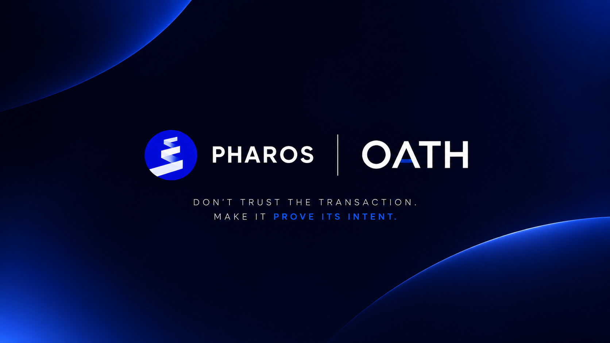
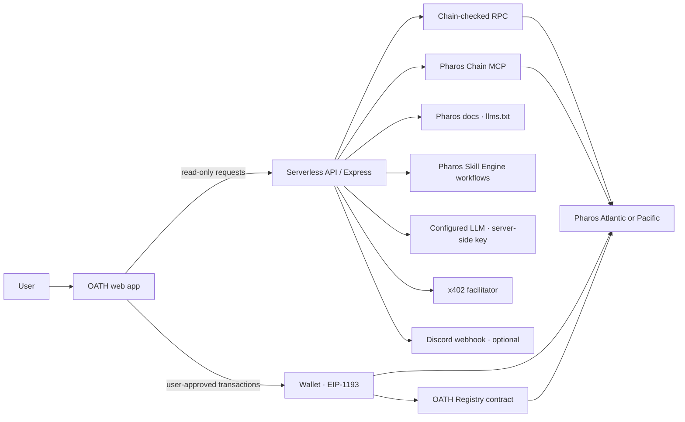

<p align="center">
  
</p>

<p align="center">
  <a href="https://www.pharos.xyz/"></a>
  
  
  
</p>

<h1 align="center">OATH · On-chain Action Trust Hub</h1>

<p align="center"><strong>Don't trust the transaction. Make it prove its intent.</strong></p>

OATH is a non-custodial Pharos dApp for people who want more context before they act on-chain. Its agent gathers chain evidence and developer guidance; OATH Gate checks and simulates supported actions before wallet approval; OATH Watch monitors activity; and the Trust Registry anchors report hashes without publishing report contents.

The connected wallet remains in control of every transaction. OATH does not ask for or store wallet private keys.

<p align="center">
  <a href="#quick-start">Quick start</a> ·
  <a href="#product-tour">Product tour</a> ·
  <a href="#architecture">Architecture</a> ·
  <a href="#deploy-to-vercel">Deploy</a> ·
  <a href="#security-model">Security</a> ·
  <a href="#challenge-readiness">Challenge readiness</a>
</p>

---

## At a glance

| Area | What it does |
|---|---|
| **OATH Core** | Investigates a Pharos wallet, contract, or transaction using chain evidence, developer docs, and Pharos skill workflows. |
| **OATH Gate** | Decodes supported native transfers and ERC-20 approvals, applies local policy limits, simulates the call, and asks the wallet to sign. |
| **OATH Watch** | Monitors balances, transaction counts, ERC-20 approval logs, and optional contract logs while the app is open. Browser and optional Discord alerts are available. |
| **Agent Marketplace** | Offers a paid, read-only research flow using x402 when a compatible facilitator is configured. |
| **Trust Registry** | Hashes report content locally and stores only the hash plus reporter and timestamp on Pharos. |

### Networks

| Network | Chain ID | Native token | Explorer |
|---|---:|---|---|
| Pharos Atlantic Testnet | `688689` | `PHRS` | [Atlantic Explorer](https://atlantic.pharosscan.xyz/) |
| Pharos Pacific Mainnet | `1672` | `PROS` | [Pharos Explorer](https://www.pharosscan.xyz/) |

OATH checks the selected chain ID on server-side RPC requests. The interface provides a network switch; connect a wallet on the same network before signing or deploying.

### Registry deployments

| Network | Registry address | Status |
|---|---|---|
| Atlantic Testnet | [`0x1e3b3cc6fdd274b60877e9472c43c8578ed5e245`](https://atlantic.pharosscan.xyz/address/0x1e3b3cc6fdd274b60877e9472c43c8578ed5e245) | Deployed |
| Pacific Mainnet | — | No deployment recorded |

Set `OATH_REGISTRY_ATLANTIC_ADDRESS` in Vercel to the Atlantic address so the app can use the known deployment consistently. Add a Pacific address only after deploying the registry on Pacific.

## Product tour

### OATH Core · investigate

Enter a research question about a wallet, contract, or transaction. The agent can call the allow-listed `run_pharos_skill` tool for structured reads, use Pharos documentation indexed by the official `llms.txt`, and produce an evidence-grounded report. If no model key is configured, OATH can still select and run its deterministic read-only workflows.

### OATH Gate · check before signing

Gate supports native transfers and standard ERC-20 `approve(address,uint256)` calls. It decodes the target and arguments, reads token decimals and current allowance, applies local spender and allowance policies, simulates with `eth_call`, and estimates gas before opening the wallet confirmation. The wallet remains responsible for signing and broadcasting.

Gate is intentionally scoped: it does not enable arbitrary contract calls or blanket NFT approvals.

### OATH Watch · monitor activity

Watch polls bounded Pharos RPC log ranges for wallet-filtered ERC-20 `Approval` events and optional contract events. It also checks native balance and transaction-count changes, and saves a local block checkpoint to resume scanning.

Watch runs in the open app. Browsers can pause background tabs, so closing the page stops monitoring. Always-on alerts need a hosted watcher or indexer and persistent alert subscriptions; that service is not included in this repository.

#### Discord alerts

Discord delivery is optional. The webhook URL is read only by the server-side `/api/alerts` handler. Add it as `DISCORD_ALERTS_WEBHOOK_URL` in Vercel, enable Discord in OATH Watch, and use **Send test alert**. The app never returns the URL to the browser, and Discord mentions are disabled in posted alerts.

### Agent Marketplace · x402 research

When enabled and supported by the configured facilitator, the marketplace returns an x402 payment challenge for a read-only report. The user reviews the network, amount, and recipient, then approves payment in their wallet. OATH waits for chain confirmation and facilitator verification/settlement before unlocking the report.

Atlantic native-PHRS payments use the challenge served by the configured facilitator. The ERC-20 `exact` flow requires a compatible EIP-3009 token and its network-specific configuration. Mainnet payments need a facilitator and asset compatible with Pacific; an Atlantic facilitator is not automatically valid on Pacific.

### Trust Registry · verify a hash

OATH calculates a SHA-256 report hash in the browser. The registry stores the hash, reporter address, timestamp, and report/policy kind; it does not store the report text. Anyone with the hash can check the on-chain record against the selected network.

The contract source is [`contracts/OathRegistry.sol`](contracts/OathRegistry.sol). Deployments are made through a connected wallet and require the correct network and gas.

## Pharos AI tooling

OATH connects its agent workflows to Pharos tools:

| Tool | Integration in OATH |
|---|---|
| **Pharos Chain MCP** | Streamable HTTP MCP client for chain context. The hosted endpoint currently serves Pacific; on Atlantic, OATH verifies the chain ID and uses the selected RPC unless an Atlantic MCP endpoint is configured. |
| **Developer Docs** | Uses the official [`https://docs.pharos.xyz/llms.txt`](https://docs.pharos.xyz/llms.txt) index to find relevant Pharos docs and retrieve Markdown excerpts. A separate docs MCP endpoint can be configured as an override. |
| **Pharos Skill Engine** | Includes an adapter for the published Pharos skill workflows: network health, wallet investigation, contract inspection, transaction analysis, failure diagnosis, allowance review, gas preparation, post-execution verification, and docs lookup. |
| **x402** | Optional pay-per-report flow. It remains disabled unless configuration and facilitator capabilities are valid for a supported payment scheme. |

The Pharos Skill Engine upstream package is an installable Agent Skill with instructions and references, not a hosted runtime API. Developers can install it with:

```bash
npx skills add https://github.com/PharosNetwork/pharos-skill-engine
```

## Architecture



### Request and trust boundaries

1. **Browser:** hosts the interface, local policy settings, report hashing, and wallet connection. API secrets are not bundled into browser code.
2. **API:** validates network context, coordinates RPC/MCP and docs reads, runs agent workflows, and delivers optional Discord alerts. Provider credentials and webhook values are server environment variables.
3. **Wallet:** signs transactions only after the user reviews the wallet prompt. OATH does not hold a signing key.
4. **Pharos:** executes user-approved transactions and stores registry hashes. Report contents remain off-chain.

## Repository map

```text
api/                         Vercel serverless endpoints
  _lib/                      RPC, network, MCP, AI and Skill Engine adapters
  agent.js                   OATH Core orchestration
  alerts.js                  Optional Discord Watch delivery
  chain.js                   Chain reads and evidence
  docs.js                    Developer docs lookup
  integrations.js            Integration status
  market.js                  x402 marketplace
  registry.js                Registry helpers
contracts/                   Solidity source
public/                       Web app, Pharos marks and registry artifact
scripts/                      Registry artifact build helper
script/                       Foundry deployment script
skills/                       OATH skill metadata
server.js                     Local Express API and static server
vercel.json                   Serverless duration and security headers
```

## Quick start

### Requirements

- Node.js **20 or newer** and npm
- A browser wallet for signing/deploying actions
- Optional: an NVIDIA or Gemini API key for model-backed agent orchestration

### Run locally

```bash
git clone https://github.com/isharik/Pharos-Oath.git
cd Pharos-Oath
npm ci
npm run compile:registry
npm run dev
```

Open the localhost URL printed by the server (port `3000` by default). Copy `.env.example` to `.env.local` and set only the values you need. The local Express server loads `.env.local`; do not commit it.

```powershell
Copy-Item .env.example .env.local
```

### Useful commands

| Command | Purpose |
|---|---|
| `npm run dev` | Start the local Express server and web app. |
| `npm start` | Start the app using the production start script. |
| `npm run compile:registry` | Compile the registry artifact used by the browser deployment flow. |
| `npm test` | Run the repository's Node test suite. |

## Configuration reference

All values below are optional unless called out. Add secrets in the hosting provider’s server-side environment settings. Never use a `NEXT_PUBLIC_` prefix for provider keys, MCP tokens, facilitator tokens, or Discord webhooks.

### AI provider

| Variable | Purpose |
|---|---|
| `AI_PROVIDER` | `auto` (default), `nvidia`, `gemini`, or `skill-engine`. Auto prefers configured NVIDIA, then Gemini, then deterministic Skill Engine workflows. |
| `NVIDIA_API_KEY` | Server-side key for the NVIDIA hosted endpoint. |
| `NVIDIA_MODEL` | Optional model override; defaults to the configured Nemotron model. |
| `NVIDIA_API_BASE_URL` | NVIDIA-compatible API base URL. |
| `GEMINI_API_KEY` | Optional Gemini key. |
| `GEMINI_MODEL` | Optional Gemini model override. |

### Pharos RPC, MCP, and docs

| Variable | Purpose |
|---|---|
| `PHAROS_ATLANTIC_RPC_URL` / `PHAROS_PACIFIC_RPC_URL` | Primary RPC endpoints. Defaults are provided in the source. |
| `PHAROS_ATLANTIC_RPC_FALLBACK_URLS` / `PHAROS_PACIFIC_RPC_FALLBACK_URLS` | Comma-separated chain-checked fallback endpoints. Watch needs providers that support `eth_getLogs`. |
| `PHAROS_MCP_URL` | Hosted Pharos Chain MCP endpoint (default `https://mcp.pharos.xyz/mcp`). |
| `PHAROS_MCP_TOKEN` | Optional bearer token for the default MCP endpoint. |
| `PHAROS_ATLANTIC_MCP_URL` / `PHAROS_ATLANTIC_MCP_TOKEN` | Optional Atlantic-specific MCP endpoint and token. |
| `PHAROS_PACIFIC_MCP_URL` / `PHAROS_PACIFIC_MCP_TOKEN` | Optional Pacific-specific MCP endpoint and token. |
| `PHAROS_DOCS_INDEX_URL` | Docs index; defaults to `https://docs.pharos.xyz/llms.txt`. |
| `PHAROS_DOCS_MCP_URL` / `PHAROS_DOCS_MCP_TOKEN` | Optional developer-docs MCP endpoint and token. |

The application verifies the selected chain ID and uses validated RPC as a fallback where configured. Do not assume that a mainnet MCP endpoint can be used for Atlantic Testnet.

### Registry and alerts

| Variable | Purpose |
|---|---|
| `OATH_REGISTRY_ATLANTIC_ADDRESS` | Address of the OATH Registry deployed on Atlantic. |
| `OATH_REGISTRY_PACIFIC_ADDRESS` | Address of the OATH Registry deployed on Pacific, if deployed. |
| `OATH_REGISTRY_ADDRESS` | Legacy Atlantic address fallback. Prefer the network-specific values above. |
| `DISCORD_ALERTS_WEBHOOK_URL` | Optional Discord webhook used only by the server-side alerts endpoint. |
| `PORT` | Local Express port; defaults to `3000`. |

### x402 facilitator

| Variable | Purpose |
|---|---|
| `X402_ENABLED` | Set to `true` to enable x402 capability checks. |
| `X402_FACILITATOR_URL` / `X402_FACILITATOR_TOKEN` | Optional shared facilitator URL and bearer token. |
| `X402_ATLANTIC_FACILITATOR_URL` / `X402_ATLANTIC_FACILITATOR_TOKEN` | Atlantic-specific facilitator configuration. |
| `X402_PACIFIC_FACILITATOR_URL` / `X402_PACIFIC_FACILITATOR_TOKEN` | Pacific-specific facilitator configuration. |
| `X402_ATLANTIC_PAY_TO`, `X402_ATLANTIC_ASSET`, `X402_ATLANTIC_PRICE_BASE_UNITS` | Atlantic ERC-20 exact-payment recipient, token contract, and positive base-unit amount. |
| `X402_PACIFIC_PAY_TO`, `X402_PACIFIC_ASSET`, `X402_PACIFIC_PRICE_BASE_UNITS` | Pacific ERC-20 exact-payment recipient, token contract, and positive base-unit amount. |

For the Atlantic native-PHRS profile, the facilitator’s challenge supplies amount and recipient dynamically. The shared `X402_ENABLED` and `X402_ATLANTIC_FACILITATOR_URL` values are the minimum for that documented setup. See [x402 deployment](#enable-x402-on-atlantic-testnet) for the end-to-end steps.

## Deploy to Vercel

1. Import `isharik/Pharos-Oath` into Vercel and keep the repository root (`.`) as the **Root Directory**.
2. Let Vercel use the repository configuration and detected Express app. Do not set a nested output directory; the app serves its UI from `public/` and exposes API handlers from `api/`.
3. Add the server-side variables required for the services you plan to use. At minimum, add an AI provider key if you want model-backed investigations. Add the registry address and x402/Discord settings only when using those features.
4. Keep secrets out of `NEXT_PUBLIC_*` variables and do not commit local `.env.local` files.
5. Deploy, then verify the deployed domain, `/api/config`, and the individual workflows you enabled.

Vercel discovers the `api/**/*.js` handlers automatically. Function duration and security headers are configured in [`vercel.json`](vercel.json).

### Add Discord Watch delivery

1. In Discord, open **Server Settings → Integrations → Webhooks**, create or select a webhook, and copy its URL.
2. In Vercel, go to **Project → Settings → Environment Variables**.
3. Add `DISCORD_ALERTS_WEBHOOK_URL` with the copied URL as the value. Select **Production** and, if needed, **Preview**.
4. Save the setting and redeploy so the running functions receive it.
5. In OATH, open **OATH Watch**, opt in to Discord, and press **Send test alert**.

Treat the webhook URL like a password. It can post to its configured channel. If it is exposed, regenerate it in Discord and replace the Vercel value. Discord delivery relays activity found while Watch is polling in the open app; it does not provide closed-browser monitoring.

## Enable x402 on Atlantic Testnet

The documented test configuration uses the existing Render facilitator at `https://octobot-x402-facilitator.onrender.com`, which advertises the Pharos native-PHRS transfer profile on Atlantic (`eip155:688689`).

1. In Vercel, open **Project → Settings → Environment Variables**.
2. Add `X402_ENABLED` with value `true`.
3. Add `X402_ATLANTIC_FACILITATOR_URL` with value `https://octobot-x402-facilitator.onrender.com`.
4. Select Production (and Preview if desired), save, and redeploy.
5. Check `https://YOUR-OATH-DOMAIN/api/market?network=atlantic`. The service should report `status: "ready"`, the `pharos-native-transfer` scheme, a price, and a recipient.
6. In the app, select **Atlantic Testnet**, connect a funded test wallet, open **Agent Marketplace**, enter a research question, and choose **Check service**.
7. Choose **Request paid report**. Review the displayed amount and recipient carefully, then approve the PHRS transfer in your wallet. OATH waits for the transaction and facilitator verification/settlement before returning the report.

The payment is an on-chain transfer and cannot be reversed once confirmed. Use a test wallet and a small testnet amount. A failed or underpaid payment must not unlock a report.

### ERC-20 exact payments

An `exact` ERC-20 facilitator must support x402 v2 on the chosen CAIP-2 network, and the payment token must implement EIP-3009 `transferWithAuthorization`. Configure that network’s facilitator, pay-to address, token address, and positive base-unit price. Supply a facilitator token only if required. Pacific needs its own compatible facilitator and asset; Atlantic native PHRS configuration does not enable Pacific payments.

## Security model

| Boundary | Safeguard |
|---|---|
| Wallet custody | No private-key input or server-side signing. EIP-1193 wallet actions require user review and approval. |
| OATH Gate | Only supported action shapes are decoded; local policy checks, call simulation, and gas estimation happen before wallet confirmation. |
| Chain reads | Server validates chain IDs and can use configured fallback RPCs. RPC evidence does not establish code safety or intent by itself. |
| Reports | Registry stores a content hash and metadata, not the report text. Reports/settings are otherwise kept in the browser. |
| API credentials | LLM, MCP, x402, and Discord secrets are server-side environment variables. Keep them out of source control and browser bundles. |
| Discord delivery | Same-origin API, webhook host/path validation, bounded payloads, mention suppression, and basic per-instance rate limiting. |
| Payments | OATH checks the facilitator challenge, network/asset/amount/recipient, transaction evidence, and facilitator verification/settlement before unlocking a paid report. |

This is a security-oriented application, not an audit certification. RPC data can be stale or unavailable; contract code, tokens, recipients, and wallet prompts still require user review. Do not use a production wallet for experimental testnet flows.

## Architecture notes

- **Frontend:** vanilla JavaScript, semantic HTML, and CSS in `public/`.
- **Hosted API:** Vercel Node functions in `api/`; local development uses the same handlers through Express in `server.js`.
- **Agent:** server-side provider selection and allow-listed tool orchestration in `api/agent.js` and `api/_lib/`.
- **RPC/MCP:** chain validation, provider fallback, and MCP helpers in `api/_lib/networks.js`, `rpc.js`, and `mcp.js`.
- **Contract:** `contracts/OathRegistry.sol`; checked-in artifact at `public/oath-registry-artifact.json`.
- **Storage:** browser local storage for user settings, local policy, watch checkpoint, and activity history. There is no persistent server-side watch subscription database.

## Challenge readiness

The app supports a public Vercel deployment; the live URL and environment variables should be confirmed in the project’s Vercel dashboard before submission. The Atlantic registry deployment is listed above. The Render facilitator setup is documented in [Enable x402 on Atlantic Testnet](#enable-x402-on-atlantic-testnet).

| Requirement | Implementation/status | What to verify or provide |
|---|---|---|
| Public Pharos dApp and contract address | App supports Atlantic and Pacific; Atlantic Registry address is listed above. | Add the live Vercel URL to the submission and verify the latest deployment and contract on Atlantic Explorer. |
| Agent and Pharos AI tooling | Chain MCP, official docs index, Skill Engine workflows, and optional x402 are integrated. | Demonstrate a live agent investigation using Pharos evidence; hosted Chain MCP currently serves Pacific, with validated RPC fallback on Atlantic unless an Atlantic MCP is configured. |
| Clear problem and usefulness | OATH helps users inspect evidence and policy-check actions before signing. | README describes audience, product, and safety purpose. |
| Safety and code quality | Non-custodial wallet flow, bounded allow-listed actions, policy checks, simulations, error handling, and server-only secrets. | Walk through a Gate simulation and explicitly show wallet approval. |
| Open-source setup and architecture | Setup, environment reference, architecture diagram, and security notes are documented here. | Add a repository-wide license file after choosing the project license; no `LICENSE` is currently included. |
| Demo video | Not included in the repository. | Record and submit the required video with a real testnet user flow. |
| Always-on Watch alerts | Not included; Watch runs while the app is open. | For background alerts after closing the browser, build/host an indexer or watcher with persistent alert subscriptions. This is an extended Watch feature, not needed for the basic challenge checklist. |

## Demo walkthrough suggestion

1. Introduce the problem: wallet actions can be hard to interpret before signing.
2. Ask OATH Core to inspect a Pharos wallet or transaction and show the evidence in its report.
3. Open OATH Gate, review a supported approval, show policy checks and simulation, then approve with a test wallet.
4. Start OATH Watch, show detected activity and send a Discord test alert.
5. Hash a report, anchor it on Atlantic Testnet, and verify the hash on-chain.
6. If x402 is enabled, show the facilitator status and a small testnet payment flow after reviewing its terms.

Never show private keys, the Discord webhook URL, or provider API keys in the recording.

## Project files and references

- [Pharos documentation](https://docs.pharos.xyz/)
- [Pharos AI](https://ai.pharos.xyz/)
- [Pharos Skill Engine](https://github.com/PharosNetwork/pharos-skill-engine)
- [Pharos Chain MCP](https://mcp.pharos.xyz/mcp)
- [Atlantic Explorer](https://atlantic.pharosscan.xyz/)
- [Pacific Explorer](https://www.pharosscan.xyz/)
- [x402 on Pharos](https://docs.pharos.xyz/developer-guide/x402)

---

<p align="center"></p>
<p align="center"><sub>Pharos OATH · Evidence over assumption.</sub></p>
